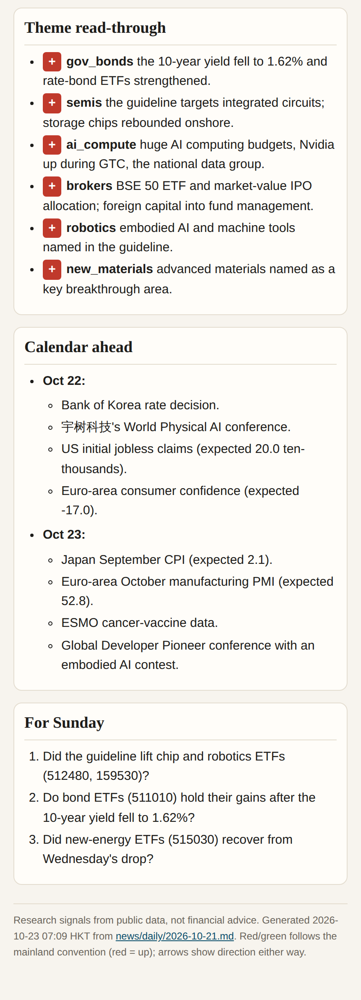

# China fund briefs

Screenshots of the latest HTML brief of each scheduled task, for the GitHub mobile app. Generated by `cfa.brief_images`; don't edit.

- [Morning brief](#morning)
- [Daily news digest](#news)
- [Sunday advice](#weekly)
- [Theme scout](#themes)

## Morning brief: Morning brief Thu Oct 22

2026-10-22 · prices as of 2026-10-21 close · updated 2026-10-22 08:23 HKT · [HTML](morning.html)

## Daily news digest: News digest 2026-10-21

News for 2026-10-21 · for the Sunday advisor · updated 2026-10-23 07:09 HKT · [HTML](news.html)

## Sunday advice: Weekly digest 2026-W42 (data as of 2026-10-16)

Week 2026-W42 · data as of 2026-10-16 · updated 2026-10-18 08:10 HKT · [HTML](weekly.html)

## Theme scout: Theme scout 2026-10 (seed)

Theme scout 2026-10 · updated 2026-10-16 20:38 HKT · [HTML](themes.html)

Source: [https://github.com/SamWongML/china-fund-agent](https://github.com/SamWongML/china-fund-agent). Research signals from public data, not financial advice.
